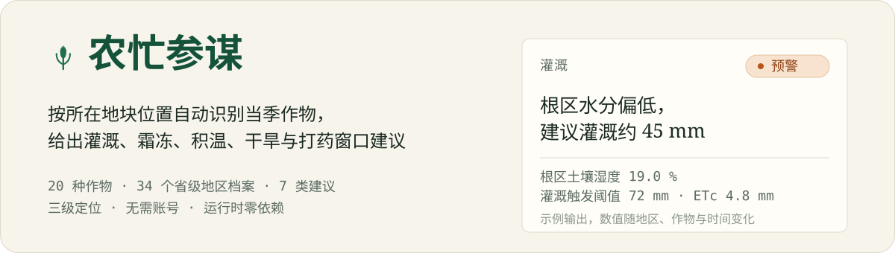
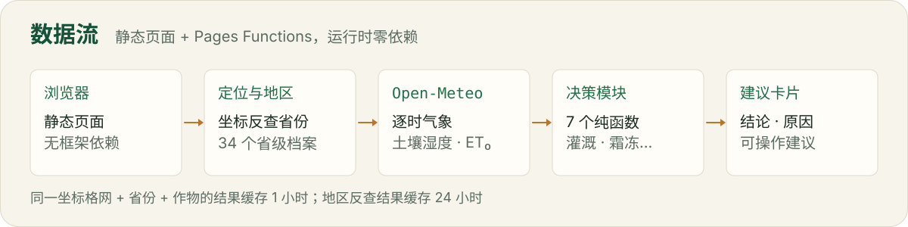

# 农忙参谋

**打开网页就知道今天该不该浇水、会不会下霜、什么时候打药。**

---

<p align="center">
  
</p>

> **它是什么** · 部署在 Cloudflare Pages 上的中文农事建议网站，静态页面 + Pages Functions。
> **它做什么** · 按访问者所在位置识别省份，自动选取当季主栽作物，套用该地区主要土类与水文参数，给出灌溉、霜冻、积温、干旱、喷洒窗口等 7 类结论化建议。
> **它不做什么** · 不展示原始气象数字，不替代实地农艺指导，不用于商业用途。

`Cloudflare Pages` · `TypeScript` · `无构建步骤` · `运行时零依赖` · `免费额度内运行`

---

## 它长什么样

每张卡片都是 **结论 → 原因 → 操作建议**，原因里带上判断所依据的数值，而不是只说"注意防范"。下面是示例输出（数值随位置、作物与时间变化）：

> ### 灌溉 · 预警
>
> **根区水分偏低，建议灌溉约 45 mm**
>
> 根区土壤体积含水量 19.0 %（假定田间持水量 32 %、凋萎点 14 %）；剩余有效水 40 mm，灌溉触发阈值 72 mm。
> 未来 24 小时作物蒸散 ETc 4.8 mm、有效降水 0.4 mm。建议灌溉量按灌溉水利用系数 0.8 折算。
> 剩余有效水仅占可利用水 28 %，低于触发阈值，需及时补水。
>
> **操作建议**
> - 建议灌溉量约 45 mm，分次给水，避免大水漫灌造成深层渗漏
> - 选择清晨或傍晚灌溉，减少蒸发损失
> - 灌溉后 2–3 天复查根区湿度，砂性土应少量多次
>
> `根区土壤湿度 19.0 %` `假定田间持水量 32 %` `根区可利用水 40 mm / 144 mm`
> `灌溉触发阈值 72 mm` `未来 24h 作物蒸散 ETc 4.8 mm` `未来 24h 有效降水 0.4 mm`

> ### 喷洒窗口 · 平稳
>
> **适宜作业：9月21日 06:00 起 3 小时（88 分）**
>
> 判定条件：风速 ≤ 5 m/s、阵风 ≤ 9 m/s、无降水且未来 6 小时雨量 < 1 mm、气温 5–32 ℃、降水概率 ≤ 70 %，
> 作业时段限 5:00–19:00。未来 48 小时筛出 4 个候选窗口，首选窗口平均风速 3.2 m/s、气温 18.6 ℃、相对湿度 74 %。
>
> **操作建议**
> - 选择清晨露水干后或傍晚作业，此时风速低、蒸发损失小
> - 核查下风向 100 m 内有无敏感作物、水源、蜂场与居民点
> - 按标签推荐剂量与用水量配药，避免重喷、漏喷
> - 施药后 6 小时内如遇降雨，视药剂耐冲刷性决定是否补喷

卡片按建议等级从高到低排列，第一张就是最该先处理的事；移动端单列、桌面端多列。

## 提供哪些建议

| 卡片 | 内容 |
| --- | --- |
| 灌溉 | 根区水量平衡，给出「需灌溉 / 等雨 / 不需灌溉」与建议灌溉量（mm） |
| 霜冻 / 热应激 | 扫描未来 48 小时最低/最高气温，判断霜冻与高温胁迫风险 |
| 生长度日 GDD | 近 14 天积温 + 未来 7 天预报积温与日均速率 |
| 干旱趋势 | 连续无有效降水天数、近 14 天降水/ET₀ 比值，并按降水预报调整等级 |
| 喷洒窗口 | 未来 48 小时逐小时打分，给出最佳作业时段与主要限制因素 |
| 水分盈亏 | 未来 7 天「有效降水 − 作物 ETc」累计盈亏与亏缺天数 |
| 病虫害风险 | 气象驱动的发生条件推断（等级上限为「预警」，不作为施药依据） |

另外：**32 种作物档案**（通用大田作物、玉米、春玉米、夏玉米、冬小麦、水稻、早稻、晚稻、大豆、马铃薯、番茄、大白菜、黄瓜、辣椒、油菜、棉花、苹果、梨、桃、葡萄、花生、芝麻、甘薯、高粱、谷子、甘蔗、向日葵、烟叶、茶、柑橘、苜蓿、青贮玉米）、**34 个省级地区档案**、**按地区自动选取当季作物**（可手动覆盖并给出**同季**备选）、**可选播种期与 FAO-56 Kc 阶段物候**、**三级定位**、**1 小时缓存**、页脚常驻的**免责声明与隐私说明**。

---

## 快速开始

需要 Node.js 18+ 与 npm。本地跑起来只需要两条命令：

```bash
npm install
npm run dev          # = wrangler pages dev public
```

打开 <http://localhost:8787>。本地预览时 `request.cf` 没有真实地理数据，自动定位会失败并引导手动选择城市；想直接看到建议，用 URL 参数指定坐标：

```text
http://localhost:8787/?lat=36.71&lon=119.10&city=潍坊
```

类型检查（可选，仓库里没有编译产物）：

```bash
npm run check        # = tsc --noEmit
```

### 部署到 Cloudflare Pages

**方式 A · wrangler 直传**

```bash
npx wrangler login
npm run deploy       # = wrangler pages deploy public
```

首次执行会提示创建 Pages 项目，名称取 `wrangler.toml` 里的 `farm-advisor`。

**方式 B · Git 集成**

推到 GitHub 后在 Cloudflare Dashboard → Workers & Pages → 创建 Pages 项目 → 连接仓库：构建命令留空，构建输出目录填 `public`。

两种方式都不需要额外的构建步骤：`functions/` 下的 `.ts` 由 wrangler 用 esbuild 自动编译打包，`public/` 就是静态资源目录。部署后可在 Pages 概览页查看请求数与 Functions 调用量，用于监控免费额度。

---

## 为什么它和一般"看天气"的页面不一样

### 地区化：作物从哪来，参数怎么分

页面默认按「省份 + 当前月份」自动选取当季作物，并显示依据（例如「按山东省（一年两熟）7 月当季『夏玉米季』自动选用」），同时给出同季备选作物供一键切换。地区差异体现在四处：

| 维度 | 做法 |
| --- | --- |
| 当季作物 | 每省配置若干「季节窗口」（作物 + 在地月份 + 播种月），按访问月份取当季首选；用户显式选择时以用户为准。备选只取**同一季节窗口**内的作物，不再跨季混排 |
| 作物细分 | 玉米拆为春玉米/夏玉米，水稻拆为单季稻/早稻/晚稻；地区季节窗口引用细分 id，手动下拉仍可单独选择 |
| 土壤水文 | 按该省主要土类覆盖作物档案里的全国经验值（田间持水量、凋萎点），并写进灌溉卡片的原因里 |
| 有效降水系数 | 湿润区（华南 0.70–0.75）低于半干旱区（西北 0.90），用于灌溉与水分盈亏核算 |
| 物候与 Kc | 用户可填播种期；未填时按季节窗口的播种月估算。用播种以来 GDD / 全生育期 GDD 推进 FAO-56 三段 Kc，灌溉与水分盈亏使用当前 Kc |
| 病虫害 | 地区重点监测名单与当前作物有交集时才加权；名单外对象不强行降级。病害判据优先使用叶面湿润概率，等级上限仍为「预警」 |

作物自身的生理参数（基点温度、Kc 曲线、霜冻与热应激阈值）**不随地区改变** —— 它们是品种属性，不是地点属性；地区只覆盖土壤水文与有效降水系数。地区档案表在 `src/lib/regions.ts`（河南 7 月会给出「夏玉米 / 花生 / 芝麻 / 甘薯 / 大豆」）。

### 定位：坐标与行政区分开处理

| 优先级 | 方式 | 精度 | 说明 |
| --- | --- | --- | --- |
| 1 | **本机定位**（`navigator.geolocation`） | 10–100 m | 浏览器直接给坐标（WGS84），需用户授权；不经过任何第三方定位 API、不需要 key |
| 2 | **手动选城市**（`/api/geocode` 代理 Open-Meteo） | 城市级 | 结果存在本机 localStorage，同时提供省名用于地区识别 |
| 3 | **网络粗定位**（`request.cf`） | 10–50 km | 默认方式，无授权、无额外请求 |

省份的解析顺序是「手选地名 → IP 行政区（仅网络定位）→ **按坐标反查** → 未识别」：

- IP 定位给的省份来自**网络出口**，设备定位给的是**真实位置** —— 两者在代理、蜂窝网络、企业出口下经常不同省。所以本机定位与手动坐标**一律按坐标反查省份**（Nominatim 为主、Photon 为备，均免费无需 key，结果缓存 24 小时），不使用 IP 省份。
- **反查失败时不回退到 IP 省份**：那会把"未识别"变成"识别错"。此时按通用大田作物计算，并提示手动选择城市。
- 换免费 IP 定位 API 收益很小（国内免费 IP 库同源，都是机房级 → 城市级）；而气象数据本身是网格模式数据（IFS ≈ 9 km、ERA5-Land ≈ 11 km），坐标精确到村口并不会改变气象变量，真正需要准的是**行政区判定**。

### 数据参考地：页面上直接告诉你建议按哪里算

页面顶部「数据参考地」显示本次建议实际使用的地名与来源，例如：

```text
数据参考地   南阳市
河南省（按坐标识别） · 本机定位 · 35.02, 112.68 · 精度约 30 米 · 玉米
```

配合坐标与精度，可以直接判断建议是否与实际地块一致；不一致时点「切换城市」修正，地区参数与当季作物会自动跟上。

---

## 数据从哪来，怎么变成建议

<p align="center">
  
</p>

```text
页面  GET /api/crops（作物目录，前端按分组生成下拉框）
   │
   └─ GET /api/advisony（不传 crop 即按地区自动选取；可带 sowing）
        │
        ▼
Pages Function  functions/api/advisony.ts
   ├─ 1 定位   request.cf 的省/市与经纬度；URL 带 lat/lon 时优先用坐标
   ├─ 2 地区   手选地名 → IP 行政区 → 坐标反查 → 未识别
   ├─ 3 作物   按「省份 + 当前月份」取当季首选，细分春/夏玉米、早/晚稻；用地区土壤参数覆盖
   ├─ 4 播种期 query 的 sowing 优先，否则按季节窗口的播种月估算；多年生作物不使用
   ├─ 5 缓存   Cache API（作物 + 省份 + 自动/手动 + 播种日期 + 坐标格网 + 小时分桶）
   ├─ 6 取数   Open-Meteo：逐时气象、日摘要、分层土壤湿度、叶面湿润、VPD、ET₀；有播种期时 past_days=92
   ├─ 7 决策   由播种期与积温推算物候/Kc，再跑 src/decision/*.ts 的七个纯函数模块
   └─ 8 响应   中文建议卡片 JSON（含 region、selection 与物候依据），并写回缓存
```

气象与土壤数据来自 **Open-Meteo**（Forecast API 与 Geocoding API）：逐时气温/湿度/风速/降水/ET₀、0–81 cm 分层土壤湿度、叶面湿润概率与 VPD。地区反查仍使用 **OpenStreetMap** 的两个免费服务（Nominatim 为主、Photon 为备，页面页脚保留 OSM 署名）。除此之外没有其它外部服务。

> 关于土壤数据库：本项目曾评估 **SoilGrids**，但实测中国区域坐标的 `wv0033` / `wv1500` / `clay` 返回 `null` 或超时（荷兰坐标正常），因此**没有**把它作为运行时依赖。土壤水文参数继续使用省级经验值，并会在灌溉卡片上如实标注。

### 缓存与免费额度

| 资源 | 免费额度 | 本项目的用法 |
| --- | --- | --- |
| Pages 静态资源 | 无限 | 单页 + CSS + JS，无外部依赖 |
| Pages Functions | 100,000 请求/天 | 仅 `/api/advisony`、`/api/crops` 与 `/api/geocode` |
| Open-Meteo | 10,000 调用/天 | 缓存 1 小时 + 边缘 `cacheTtl` 600 秒；有播种期时 `past_days=92`，其余情况 14 天 |
| KV / D1 | — | **不使用**，缓存只用运行时 Cache API |

- 缓存 key 为 `作物 + 自动/手动 + 省份 + 定位来源 + 播种日期 + 纬度(2 位小数) + 经度(2 位小数) + 小时分桶`，同一格网内同一作物、同一选取方式、同一播种期的用户共享同一份**决策结果**。作物目录 `/api/crops` 单独缓存 24 小时。
- **缓存体里不含任何请求者相关信息**：只存气象派生的卡片、摘要与地块时区；城市名、经纬度、定位来源在每次响应时按当前请求者重新组装。否则同一格网内后到的用户会看到前一个用户的 IP 定位城市名与坐标。
- IP 定位的请求 URL 对所有用户都一样：响应下发 `Cache-Control: private, max-age=300`，并额外加 `CDN-Cache-Control: no-store`，阻止 CDN 按 URL 缓存造成地区串味。手动指定坐标的 URL 自带参数，可用 `public, max-age=3600`。
- 页面「刷新」按钮带 60 秒冷却，避免连续点击消耗上游配额。

---

## 接口

### `GET /api/advisony`

| 参数 | 说明 |
| --- | --- |
| `lat`、`lon` | 手动指定坐标；两者同时合法时优先于 IP 定位 |
| `src` | 坐标来源标记：传 `device` 表示来自浏览器本机定位（响应里的 `location.source` 会如实回显） |
| `city`、`region` | 手动指定的地名，仅用于展示；`region` 同时参与省份识别 |
| `crop` | 作物 id（见 `src/lib/crops.ts`，如 `corn`、`corn_summer`、`rice_late`、`cabbage`）；**默认 `auto`**，按所在省份与当前月份自动选取当季作物；传具体 id 则固定该作物 |
| `sowing` | 可选，播种日期 `YYYY-MM-DD`；不传时按地区季节窗口的播种月估算。多年生作物忽略该参数 |
| `force=1` | 跳过缓存读取，强制重新取数（前端有 60 秒冷却） |

<details>
<summary>成功响应示例（<code>ok: true</code>）</summary>

```jsonc
{
  "ok": true,
  "generatedAt": "2026-09-20T06:12:33.000Z",
  "location": { "name": "潍坊", "region": "山东省", "lat": 36.71, "lon": 119.1,
                "source": "ip", "timezone": "Asia/Shanghai" },
  "crop": { "id": "corn_summer", "name": "夏玉米" },
  "region": { "code": "SD", "name": "山东省", "climateZone": "黄淮海平原",
              "croppingSystem": "一年两熟", "soilNote": "潮土与棕壤，胶东丘陵偏砂",
              "effectiveRainFactor": 0.82, "placeName": "潍坊", "matchedBy": "region_code" },
  "selection": { "auto": true, "reason": "按山东省（一年两熟）9 月当季「夏播季」自动选用",
                 "seasonLabel": "夏播季",
                 "alternatives": [ { "id": "peanut", "name": "花生" }, { "id": "soybean", "name": "大豆" } ],
                 "sowingDate": "2026-06-01", "sowingSource": "region",
                 "phenology": { "stage": "mid", "stageLabel": "旺盛期", "kc": 1.15,
                                "progress": 0.62, "gddSinceSowing": 713,
                                "gddToMaturity": 1150 } },
  "current": { "timeLabel": "9月20日 14:00", "temperature": 24.3, "humidity": 62,
               "windSpeed": 2.1, "soilMoisture": 19.0, "soilTemperature": 22.8,
               "precipitation1h": 0, "et0Today": 3.4 },
  "summary": { "level": "warn", "headline": "根区水分偏低，建议灌溉约 45 mm", "focusId": "irrigation" },
  "cards": [
    {
      "id": "irrigation", "category": "灌溉", "level": "warn", "levelLabel": "预警",
      "headline": "根区水分偏低，建议灌溉约 45 mm",
      "reason": "根区土壤体积含水量 19.0 %……",
      "actions": ["建议灌溉量约 45 mm，分次给水，避免大水漫灌造成深层渗漏", "……"],
      "metrics": [{ "label": "根区土壤湿度", "value": "19.0 %" }]
    }
  ],
  "notices": ["土壤水文参数已按山东省（黄淮海平原）主要土类修正：潮土与棕壤，胶东丘陵偏砂；有效降水系数取 0.82。"],
  "source": { "weather": "Open-Meteo", "cache": "MISS" }
}
```

`cards` 按建议等级从高到低排序，第一张就是最需要先处理的事情；`level` 取 `ok` / `watch` / `warn` / `alert`。`region.matchedBy` 取 `region_code` / `region_name` / `reverse_geocode`，说明省份是怎么认出来的。

</details>

失败时返回 `ok: false`，HTTP 状态仍为 200，便于前端统一处理：

```jsonc
{ "ok": false, "code": "locate_failed",
  "message": "无法根据网络位置判断你所在的地区，请手动选择城市。", "fallback": true }
```

`code` 取值：`locate_failed`（定位失败，引导手动选城市）、`upstream_error`（气象数据源失败）、`bad_request`、`internal_error`。

### `GET /api/crops`

作物目录，返回 `{ ok: true, groups, crops: [{ id, name, group, perennial }] }`，结果缓存 24 小时。前端据此动态生成分组下拉框，新增作物时不再需要改 `index.html`。

### `GET /api/geocode?q=潍坊`

城市检索代理，返回 `{ ok: true, query, results: [{ name, region, country, latitude, longitude, timezone }] }`，结果缓存 24 小时。

---

## 决策口径与已知局限

每个模块的完整算法与阈值都写在对应源文件的头部注释里，要点如下：

- **灌溉**：`ETc = ET₀ × Kc`；有效降水按地区系数（0.70–0.90）；根区土壤湿度取 0–1 / 3–9 / 9–27 / 27–81 cm 四层，按作物根深截断后加权；剩余有效水低于 `TAW × 触发比例` 时建议灌溉，灌溉量按灌溉水利用系数 0.8 折算并限幅。Kc 在有播种期时按物候阶段动态取值。
- **物候 / Kc**：从播种日期起累计 GDD，按全生育期 GDD 的比例划分苗期/发育期/旺盛期/成熟期，用 FAO-56 三段 Kc 曲线插值。播种期优先用用户输入，否则按季节窗口的播种月估算；多年生作物不推算。
- **霜冻 / 热应激**：用 2 m 气温判定，阈值外扩 2 ℃ 作为「关注」档 —— 晴夜地表温度通常比 2 m 气温再低 1–2 ℃。
- **生长度日**：截断法 `max(0, clamp(日均温, 基温, 上限) − 基温)`。有播种期时同时报告播种以来积温、全生育期参考与生育进度；没有播种期时只报告积温收支。
- **干旱趋势**：连续无有效降水天数（单日 < 1 mm 记为无效）+ 近 14 天降水/ET₀ 比值；未来 7 天降水能覆盖同期蒸散 80 % 以上时下调一级。
- **喷洒窗口**：风速 5 m/s、阵风 9 m/s、未来 6 小时雨量 1 mm、气温 5–32 ℃、降水概率 70 %、时段 5:00–19:00 是硬性排除条件；VPD 与蒸发强度作为扣分项（VPD >2.5 kPa 或 <0.4 kPa 降分）。
- **病虫害**：用近 3 天温湿、降水与**叶面湿润概率**推断「是否有利于发生」；需湿型病害可用叶面湿润小时数替代降水判据。未接入田块虫情与区域测报，**等级上限为「预警」**。
- **历史数据**：`past_days=14`（有播种期时 92）取的是**过去的模式预报**，不是气象站实测，用于趋势判断足够，但不能当作观测值。

已知局限（页面上也会如实提示）：

1. 土壤水文参数（田间持水量、凋萎点、根区深度）来自作物档案里的经验假定值，**没有接入 SoilGrids 等土壤数据库**；实测 SoilGrids 中国区域坐标返回 `null`/超时，因此暂不作为运行时依赖。地区档案只按「该省主要土类」做量级修正，不是地块实测值。灌溉建议是量级正确的参考值，不能替代土壤检测。
2. **地区档案表（`src/lib/regions.ts`）是按公开统计年鉴、种植业区划与各省栽培技术规程经验整理的**，作物结构与熟制为量级排序而非精确统计；定位粒度只到省份，无法判断同一省内不同县市的实际种植结构，请以田间实际情况或当地农技部门信息为准。
3. **作物档案覆盖 32 种常见大田、经济、蔬菜、果树与饲草作物**，仍未覆盖花卉、多数地方特色作物与全部品种；这些地块请选择「通用大田作物」，其参数为通用经验值，精度低于专用档案。
4. 水稻以田面水层管理为主，土壤湿度判据对它的参考性有限。
5. IP 定位精度约为城市级，可能落在相邻地市；用「切换城市」修正，或点「使用本机定位」直接取设备坐标。反查服务超时或被限流时会退回「未识别地区」，而不是用 IP 省份猜测。
6. 病虫害的温湿阈值与地区重点监测名单为经验整理值，建议由植保人员复核后再用于生产决策。
7. **播种期与物候**：播种期未填写时按季节窗口的播种月 1 日估算，可能与实际播期相差数天到两周；全生育期 GDD 与 Kc 阶段比例是公开资料的经验量级值，不是品种实测值。播种日期早于 92 天数据窗口时无法累计完整积温，此时会退回作物档案的单值 Kc。

---

## 项目结构

<details>
<summary>展开目录树</summary>

```text
farm-advisor/
├── public/                      # Pages 静态输出目录
│   ├── index.html               # 移动端优先的单页界面
│   ├── style.css                # 含深色模式，无外部字体与图标
│   └── app.js                   # 原生 ES 模块，无构建、无第三方依赖
├── assets/readme/               # 本 README 的素材（纯 SVG）
│   ├── hero.svg
│   └── data-flow.svg
├── functions/api/
│   ├── advisony.ts              # GET /api/advisony：定位 → 地区 → 作物/播种期 → 缓存 → 取数 → 物候/决策
│   ├── crops.ts                 # GET /api/crops：作物目录（前端动态下拉框）
│   └── geocode.ts               # GET /api/geocode：城市检索代理
├── src/lib/
│   ├── types.ts                 # 共享类型，也是接口响应契约
│   ├── util.ts                  # NaN 安全的数值与格式化工具
│   ├── agro.ts                  # 积温、Kc 阶段与物候纯函数
│   ├── crops.ts                 # 32 种作物参数档案（含 Kc 阶段与全生育期 GDD）
│   ├── regions.ts               # 34 个省级地区档案（当季作物 / 播种月 / 土壤 / 灾害重点）
│   ├── reverseGeo.ts            # 坐标 → 省份反查（Nominatim 主 / Photon 备）
│   ├── http.ts                  # Pages Functions 助手（JSON / Cache / cf 解析）
│   └── openmeteo.ts             # Open-Meteo 客户端与数据规范化（含三级降级）
├── src/decision/
│   ├── irrigation.ts  frost.ts  gdd.ts  drought.ts
│   ├── spray.ts  waterBalance.ts  pest.ts
│   └── index.ts                 # 编排：卡片汇总、摘要、当前条件
├── wrangler.toml · package.json · tsconfig.json
└── functions/tsconfig.json
```

`functions/api/advisony.ts` 用相对路径 `../../src/decision/index` 引入共享决策模块 —— 这是 Cloudflare 官方支持的用法（[Module support](https://developers.cloudflare.com/pages/functions/module-support/)），把共享代码放在 `functions/` 之外也避免它被文件路由当成接口。`functions/tsconfig.json` 是 Cloudflare 建议的做法，防止根 `tsconfig.json` 干扰函数打包。

</details>

### 新增一种作物

在 `src/lib/crops.ts` 的 `CROPS` 数组里追加一份档案（分组、基点/上限温度、Kc 单值与 `kcStages`、`gddToMaturity`、霜冻与热应激阈值、土壤水文假定、根区深度、灌溉触发比例、病虫害模型）。`GET /api/crops` 会自动把新作物加入前端分组下拉框，**无需再改 `index.html`**；要让新作物参与地区自动选取，还需在 `src/lib/regions.ts` 相关省份的 `seasons[].crops` 里加入该 id（顺序即当季优先级），并给该季节窗口补 `sowingMonth`。

### 修改地区档案

`src/lib/regions.ts` 的 `REGIONS` 数组：`seasons` 决定「几月在种什么、什么时候播」，`overrides` 提供土壤参数与有效降水系数，`pestPriority` 列出该省重点监测的病虫害 id。备选作物只从同一 `seasons[].crops` 中取，不会跨季混排。

改动后请递增 `functions/api/advisony.ts` 的 `CACHE_VERSION`，避免旧缓存继续下发旧参数。作物 id 必须与 `crops.ts` 一致，病虫害 id 必须出现在对应作物的 `pests[].id` 里。

---

## 隐私、免责与许可

**隐私** 本站不设账号、不使用追踪 Cookie，也不收集个人身份信息。默认情况下，服务端读取 Cloudflare 提供的访问者 IP 粗定位信息（省/市与经纬度，精度约城市级），仅用于判断所在省份与向气象数据源请求对应位置的天气；该信息不会写入数据库，也不会随响应返回给其他用户。点「使用本机定位」时，位置由浏览器直接提供（WGS84，精度可达几十米，需用户授权），仅在本次请求中发往服务端用于取数，不写入数据库；拒绝授权即退回网络定位，不影响使用。手动选择的城市只保存在本机浏览器的 localStorage 中，点「切换城市 → 使用网络位置」即可清除。

**免责** 页面输出的一切建议由公开气象与土壤模式数据自动生成，仅供参考，不构成农艺指导，请结合田间实际情况判断后使用。

**许可** 代码仅供个人 / 非商业用途；Open-Meteo 免费层同样限非商业使用，商业用途需另行申请许可或更换数据源。数据来源：[Open-Meteo](https://open-meteo.com/)（CC BY 4.0）、[OpenStreetMap 贡献者](https://www.openstreetmap.org/copyright)（ODbL，用于坐标反查）。
